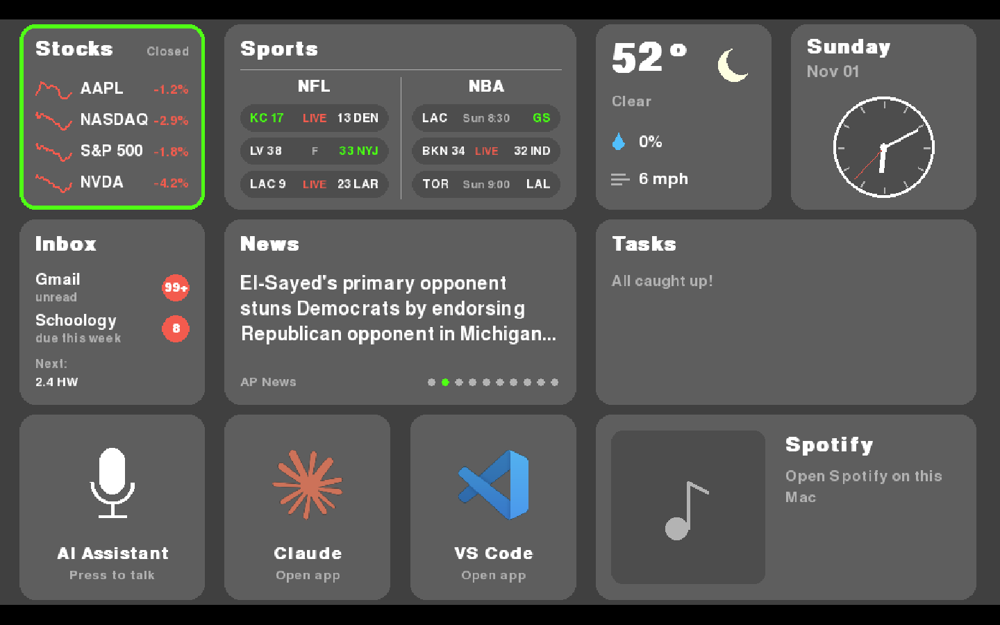

# Atlas



**Atlas** is a personal desktop dashboard built with Python and Pygame. It brings useful information, applications, and everyday tools together into one centralized interface.

The dashboard displays live information from several services, including stocks, sports, weather, news, email, and tasks. It also provides quick access to applications such as Spotify, Claude, and Visual Studio Code.

The project was designed to run as a fullscreen dashboard and can be navigated using keyboard controls or an external serial controller.

## Features

Atlas is made up of individual tiles, each responsible for a different feature.

| Tile | Description |
|---|---|
| **Stocks** | Displays stock market information, including Apple, NVIDIA, the NASDAQ, and S&P 500. |
| **Sports** | Retrieves sports scores and updates for selected NFL and NBA teams. |
| **Weather** | Displays current weather information using the Open-Meteo API. |
| **Date & Time** | Shows the current date and an analog clock. |
| **Gmail & Schoology** | Displays unread Gmail messages and Schoology calendar information. |
| **News** | Retrieves news headlines through RSS feeds. |
| **Tasks** | Connects to Google Tasks to display task information. |
| **AI Assistant** | Provides an interface tile for a planned voice assistant feature. |
| **Claude** | Provides quick access to the Claude desktop application or website. |
| **VS Code** | Provides quick access to Visual Studio Code. |
| **Spotify** | Displays currently playing music information and provides playback controls. |

## Technologies Used

- **Python** – Main programming language.
- **Pygame** – Dashboard interface and graphics.
- **PySerial** – Communication with an external controller.
- **Requests** – HTTP requests to external APIs.
- **yfinance** – Stock market data.
- **Open-Meteo API** – Weather information.
- **ESPN API** – Sports scores and information.
- **Google APIs** – Gmail and Google Tasks integrations.
- **Feedparser** – RSS news feeds.
- **AppleScript** – macOS application integration and Spotify controls.

## Project Structure

```text
Atlas/
│
├── interface.py       # Main dashboard interface
├── controller.py      # Serial controller communication
├── tile_utils.py      # Shared tile utilities and drawing functions
│
├── stocks_tile.py     # Stock market tile
├── sports_tile.py     # Sports scores tile
├── weather_tile.py    # Weather tile
├── date_tile.py       # Date and clock tile
├── gmail_tile.py      # Gmail and Schoology integration
├── news_tile.py       # News headlines tile
├── tasks_tile.py      # Google Tasks integration
├── spotify_tile.py    # Spotify integration
├── ai_tile.py         # AI assistant interface
├── claude_tile.py     # Claude application launcher
├── vscode_tile.py     # Visual Studio Code launcher
│
├── google_auth.py     # Google authentication
│
└── .gitignore
```

## How It Works

### Dashboard Interface

The main interface is built using Pygame and organizes each feature into its own tile. The dashboard runs in fullscreen mode and updates information from the different integrations.

### Modular Design

Each tile is maintained in a separate Python file. This makes it easier to develop, modify, and add features without having to rewrite the entire dashboard.

### Background Updates

Background threads are used to retrieve information from external services without constantly blocking the main interface.

### Controller Integration

The project uses PySerial to communicate with an external controller. Controller input is processed separately from the main dashboard, allowing the interface to respond to physical controls.

## Setup

### 1. Clone the Repository

```bash
git clone https://github.com/RianThomas/Atlas.git
cd Atlas
```

### 2. Create a Virtual Environment

```bash
python3 -m venv .venv
source .venv/bin/activate
```

### 3. Install Dependencies

```bash
pip install pygame pyserial requests python-dotenv icalendar feedparser yfinance google-api-python-client google-auth google-auth-oauthlib
```

### 4. Configure Google Authentication

Some features use Google services, including Gmail and Google Tasks.

To enable these integrations:

1. Create a project in the Google Cloud Console.
2. Enable the Gmail API and Google Tasks API.
3. Configure OAuth credentials for a desktop application.
4. Download the OAuth credentials file.
5. Place the credentials file in the project directory.
6. Complete the authentication process when prompted.

Keep authentication files and tokens private. They should never be committed to a public repository.

### 5. Configure Environment Variables

If using the Schoology calendar integration, configure its calendar URL in a `.env` file.

### 6. Run Atlas

```bash
python interface.py
```

**Note:** Some integrations are designed around macOS applications and system tools. Spotify controls use AppleScript, while the Claude and VS Code tiles attempt to open their respective desktop applications. The serial controller port may also need to be changed to match your hardware.

## Customization

Atlas is designed to be expandable. Individual tiles can be modified or new ones can be added to introduce additional functionality.

Possible customizations include:

- Changing the stocks or sports teams displayed.
- Modifying the dashboard layout.
- Adding new API integrations.
- Creating additional tiles.
- Adjusting refresh intervals.
- Expanding the controller functionality.

## Development & AI Disclosure

**Atlas was independently designed, developed, and implemented by me.** The project's architecture, interface, Python code, features, and integrations were created by me.

AI tools were used for **code troubleshooting and README creation only**. AI was not used to independently develop or implement the project's features.

---

**Created by Rian Thomas**

[GitHub Repository](https://github.com/RianThomas/Atlas)
